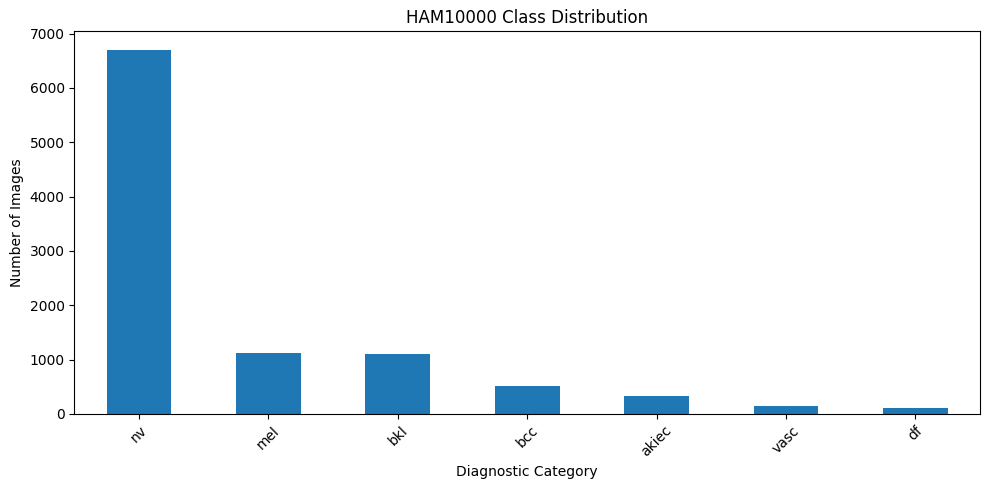
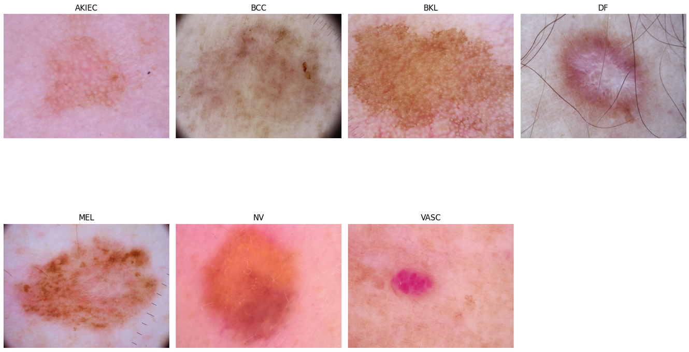
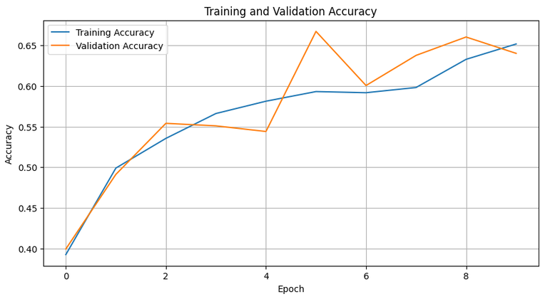
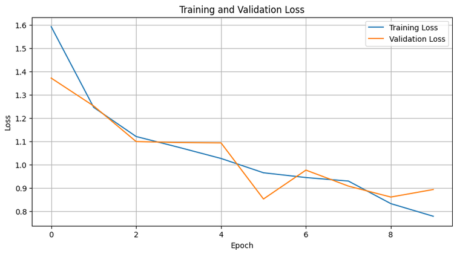
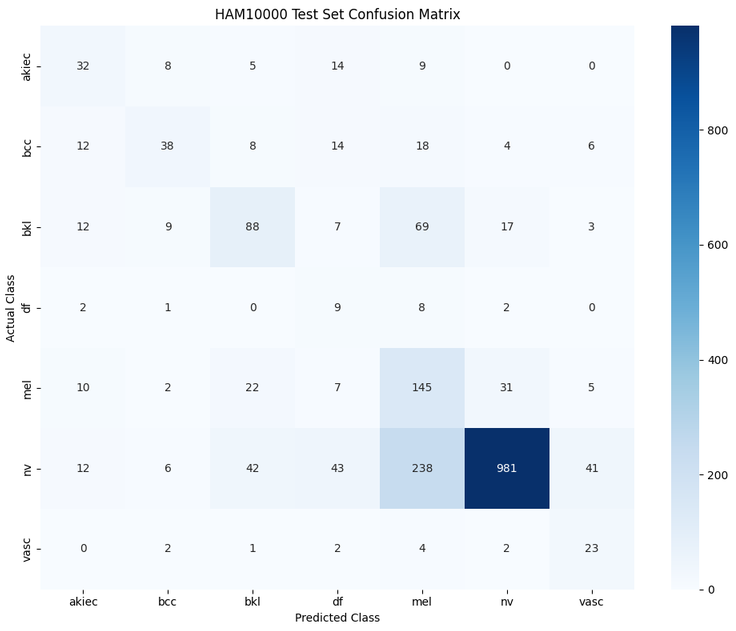
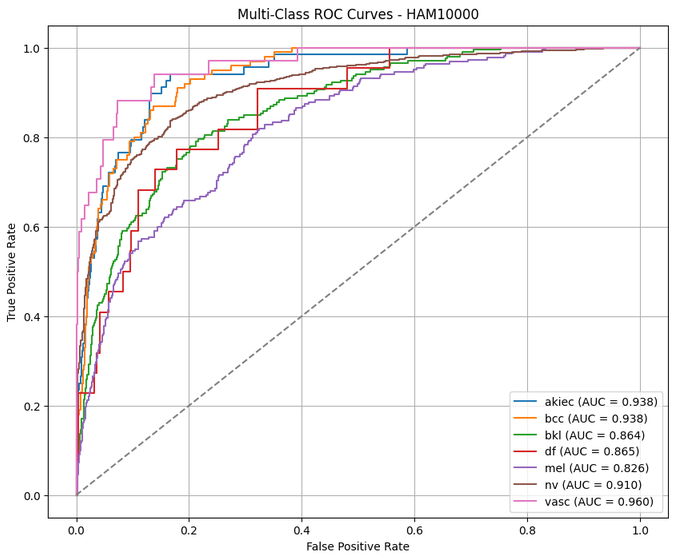
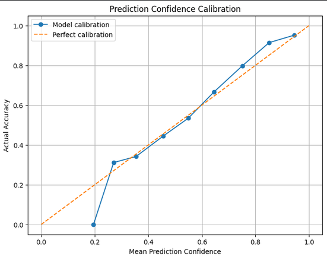

# HAM10000 Skin Lesion Classification Using Deep Learning

## Project Overview
A seven-class skin lesion image classification project using deep learning and transfer learning with EfficientNetB0.

## Dataset
- Dataset: HAM10000
- Total images: 10,015
- Number of classes: 7
- Image type: Dermatoscopic images
- Source: [HAM10000 Dataset – Kaggle](https://www.kaggle.com/datasets/kmader/skin-cancer-mnist-ham10000)

## Methodology
- Image preprocessing and augmentation.
- Lesion-level grouped train, validation and test splitting.
- EfficientNetB0 transfer learning with ImageNet weights.
- Class-weighted training to address class imbalance.
- Model evaluation using accuracy, macro F1-score, balanced accuracy and ROC-AUC.

## Model Performance

| Metric | Result |
|---|---:|
| Test Accuracy | 65.34% |
| Macro F1-score | 45.03% |
| Balanced Accuracy | 53.40% |
| Macro ROC-AUC | 0.9003 |

## Project Visualisations

### Dataset Class Distribution

### Sample Images

### Training and Validation Accuracy

### Training and Validation Loss

### Confusion Matrix

### Multiclass ROC Curves

### Prediction Confidence Calibration

## Technologies Used
- Python
- TensorFlow / Keras
- EfficientNetB0
- Scikit-learn
- NumPy
- Pandas
- Matplotlib
- Google Colab

## Limitations
This is an educational machine learning project. Performance varies across classes, and the model has not been clinically validated for medical diagnosis.

## Implementation
The complete implementation, including preprocessing, model training and evaluation, is available in `HAM10000_Classification.ipynb`.
